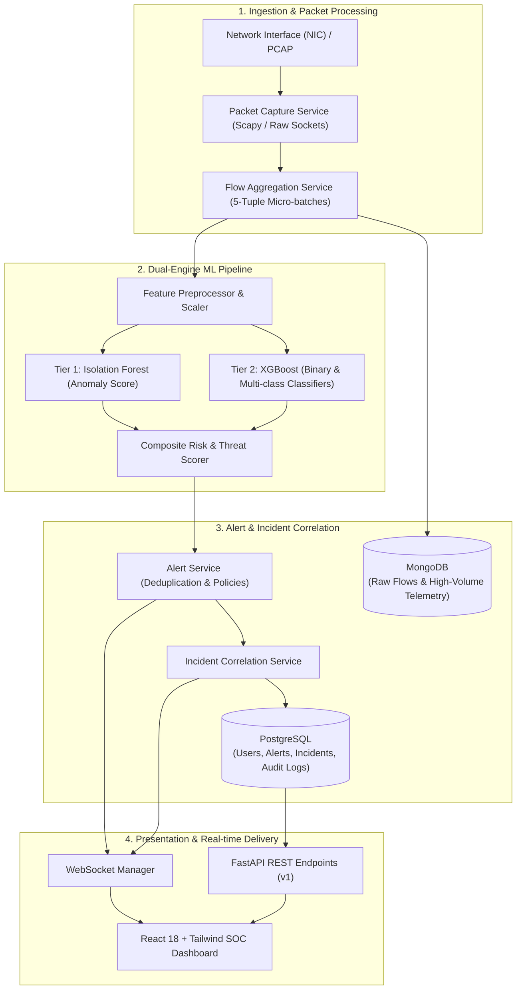

# 🛡️ NetShield AI

### Enterprise AI-Powered Network Anomaly Detection & Threat Monitoring System

[](https://www.python.org/)
[](https://fastapi.tiangolo.com/)
[](https://react.dev/)
[](https://tailwindcss.com/)
[](https://vitejs.dev/)
[](https://www.postgresql.org/)
[](https://www.mongodb.com/)
[](https://xgboost.readthedocs.io/)
[](https://scikit-learn.org/)
[]()
[](LICENSE)

---

## 📌 Executive Summary

**NetShield AI** is a next-generation, high-performance Network Intrusion Detection & Threat Monitoring Platform engineered for Security Operations Centers (SOC). Combining unsupervised zero-day anomaly detection with supervised multi-class gradient boosting, NetShield AI continuously intercepts, parses, aggregates, and scores network packet flows in real time. 

The system couples a reactive **FastAPI + WebSocket** backend with an intuitive, modern **React 18 + Tailwind CSS** security console, providing security analysts and administrators with sub-second threat visibility, automated alert deduplication, incident correlation, and complete forensic audit logging.

---

## 🚀 Key Features

### 1. 📡 Real-Time Packet Capture & Flow Aggregation
- **Dynamic Capture Engine**: Intercepts live network packets across interfaces using Scapy / raw sockets, featuring fallback synthetic telemetry generators for sandbox testing.
- **5-Tuple Micro-Batch Flow Aggregation**: Binds connection states across Source IP, Destination IP, Source Port, Destination Port, and Protocol to generate bidirectional flow vectors (durations, packet sizes, inter-arrival jitters, packet rates).

### 2. 🧠 Two-Tier Machine Learning Threat Engine
- **Tier 1 (Unsupervised Anomaly Detection - Isolation Forest)**:
  - Detects novel zero-day behavioral deviations without requiring attack labels.
  - Trained exclusively on benign network baselines with strict programmatic guards preventing label contamination.
- **Tier 2 (Supervised Threat Classification - XGBoost)**:
  - **Binary Classifier**: Predicts whether a connection flow is benign or malicious.
  - **Multiclass Classifier**: Granularly maps malicious flows into attack families (DoS Hulk, DDoS, PortScan, Infiltration, Web Attacks, Exploits, Fuzzers, Backdoor, Reconnaissance).

### 3. 🎯 Multi-Factor Risk & Threat Scoring Engine
- Implements a composite threat scoring formula:
  $$\text{Threat Score} = w_1 \cdot \text{AnomalyScore} + w_2 \cdot P(\text{Attack}) + w_3 \cdot \text{SeverityWeight} + w_4 \cdot \text{AssetPriority}$$
- Normalizes threat metrics into clear risk tiers: **CRITICAL**, **HIGH**, **MEDIUM**, and **LOW**.

### 4. ⚡ Alert Generation, Deduplication & Policy Enforcement
- **Sliding-Window Deduplication**: Prevents alert fatigue by aggregating identical 5-tuple alerts within configurable timeframes.
- **Rule & Policy Management**: Dynamically routes alerts to SOC channels or promotes high-severity events.

### 5. 🔗 Automated Incident Correlation & Lifecycle Workflow
- **Graph & Heuristic Correlation**: Automatically correlates related temporal and spatial alerts into consolidated **Incidents**.
- **Incident State Tracking**: Manages lifecycle states: `OPEN` $\rightarrow$ `INVESTIGATING` $\rightarrow$ `MITIGATED` $\rightarrow$ `RESOLVED` $\rightarrow$ `CLOSED`.

### 6. 📊 Real-Time SOC Dashboard & WebSocket Streaming
- Sub-second bi-directional WebSocket push (`/api/v1/monitoring/ws/live`).
- Interactive live threat radar, packet counters, active alert drawers, and timeline visualizations.

### 7. 🔐 Enterprise RBAC & SOC Forensic Audit Trails
- JSON Web Token (JWT) stateless auth with Argon2/Bcrypt password hashing.
- Role-Based Access Control differentiating **Security Admin** (system control, audit logs, configuration) from **Security Analyst** (monitoring, incident triage, capture).
- Immutable, tamper-evident audit logging recording all SOC operations.

### 8. 🔬 Interactive Model Registry & Dataset Profiler
- In-depth dataset explorative tooling for **CICIDS2017** and **UNSW-NB15**.
- Built-in visualizer for confusion matrices, ROC/PR curves, and feature importance rankings.

---

## 🏛️ System Architecture



---

## 🛠️ Technology Stack

| Domain | Technology / Library | Purpose |
| :--- | :--- | :--- |
| **Backend Framework** | **FastAPI** | High-performance asynchronous REST API & WebSocket endpoints |
| **Runtime & Language** | **Python 3.12+** | Core server runtime and processing engine |
| **Frontend Framework** | **React 18 + Vite** | High-performance SPA security dashboard |
| **UI Styling & Icons** | **Tailwind CSS + Lucide React** | Modern dark-mode SOC interface with responsive design |
| **Relational Database** | **PostgreSQL (SQLAlchemy)** | ACID store for Users, Roles, Alerts, Incidents, and Audit Logs |
| **Document Database** | **MongoDB (PyMongo)** | High-throughput document store for high-volume network flow events |
| **Machine Learning** | **Scikit-Learn, XGBoost, Joblib** | Isolation Forest anomaly detection, Gradient Boosted tree classifiers |
| **Data Processing** | **Pandas, NumPy** | Statistical flow aggregation, feature scaling, and data transformations |
| **Packet Inspection** | **Scapy, Raw Sockets** | Layer 3/4 packet dissection, protocol filtering, and PCAP analysis |
| **Authentication & Security** | **JWT (python-jose), Bcrypt** | Stateless RBAC auth, cryptographic hashing, and secure sessions |
| **Quality & Testing** | **Pytest, AnyIO** | Automated test suite (58 unit and integration tests passing) |

---

## 📈 Machine Learning Performance & Benchmarks

NetShield AI was trained and validated on industry benchmark datasets: **CICIDS2017** (Canadian Institute for Cybersecurity) and **UNSW-NB15** (Australian Cyber Security Centre).

### 1. Supervised Threat Detection (XGBoost Binary Classifier)

| Metric | CICIDS2017 Test Set | UNSW-NB15 Test Set |
| :--- | :---: | :---: |
| **Accuracy** | **99.46%** | **98.80%** |
| **Precision** | **97.95%** | **93.27%** |
| **Detection Rate (Recall)** | **99.31%** | **97.98%** |
| **F1-Score** | **98.62%** | **95.57%** |
| **False Positive Rate (FPR)** | **0.50%** | **1.08%** |

### 2. Supervised Attack Classification (XGBoost Multiclass)

| Dataset | Overall Accuracy | Weighted F1-Score | Key Detected Attack Classes |
| :--- | :---: | :---: | :--- |
| **CICIDS2017** | **99.33%** | **99.21%** | DDoS, DoS Hulk, PortScan, Infiltration, Web Attacks |
| **UNSW-NB15** | **98.13%** | **98.20%** | Generic, Exploits, DoS, Reconnaissance, Fuzzers |

### 3. Unsupervised Zero-Day Anomaly Detection (Isolation Forest)
- **Model Strategy**: Dedicated independent models fit exclusively on benign traffic profiles.
- **Objective**: Identifies unseen behavioral anomalies without prior signature knowledge.
- **Inference Latency**: Sub-millisecond scoring per flow batch ($< 2\text{ms}$).

---

## 📂 Project Directory Structure

```text
NetShieldAI/
├── backend/                        # FastAPI Backend Application
│   ├── app/
│   │   ├── api/v1/                 # Versioned REST and WebSocket routes
│   │   │   ├── endpoints/          # Route handlers (auth, users, alerts, incidents, etc.)
│   │   │   └── api.py              # Root API router aggregator
│   │   ├── config/                 # Pydantic BaseSettings & app configuration
│   │   ├── core/                   # JWT creation, security handlers, password hashing
│   │   ├── datasets/               # Dataset loader and statistics profiler
│   │   ├── db/                     # PostgreSQL (SQLAlchemy) & MongoDB connections
│   │   ├── models/                 # SQLAlchemy ORM database models
│   │   ├── monitoring/             # Packet capture & raw network sniffing
│   │   ├── schemas/                # Pydantic validation schemas
│   │   ├── services/               # Core business & ML detection services
│   │   └── main.py                 # Application entry point & lifespan events
│   ├── .env.example                # Backend environment variable template
│   └── requirements.txt            # Python dependencies
│
├── frontend/                       # React 18 + Vite Frontend Application
│   ├── public/                     # Static assets and icons
│   ├── src/
│   │   ├── assets/                 # Brand images and banners
│   │   ├── components/             # Reusable UI widgets (AlertDrawer, Modals, etc.)
│   │   ├── layouts/                # DashboardLayout with sidebar navigation
│   │   ├── pages/                  # Route views (Dashboard, Sniffer, Incidents, etc.)
│   │   ├── services/               # Axios API client and WebSocket handlers
│   │   ├── App.jsx                 # Route definitions & ProtectedRoute guards
│   │   └── main.jsx                # React DOM root entry
│   ├── package.json                # Frontend dependencies
│   ├── tailwind.config.js          # Tailwind CSS styling config
│   └── vite.config.js              # Vite bundler configuration
│
├── ml/                             # Machine Learning Subsystem
│   ├── anomaly_detection/          # Isolation Forest training and inference
│   ├── intrusion_prediction/       # XGBoost binary and multiclass training pipelines
│   ├── risk_scoring/               # Multi-factor threat risk scoring logic
│   ├── threat_detection/           # End-to-end unified ML detection pipeline
│   ├── models/                     # Serialized preprocessors and trained joblib models
│   └── reports/                    # Evaluation JSON reports, confusion matrices, charts
│
├── datasets/                       # Datasets & Processed Splits
│   ├── CICIDS2017/                 # CICIDS2017 processed matrices and documentation
│   ├── UNSW-NB15/                  # UNSW-NB15 processed matrices and features
│   └── processed/                  # Lightweight testing and evaluation samples
│
├── docs/                           # Technical architecture & milestone documentation
├── tests/                          # Automated Pytest suite
│   ├── backend/                    # API, WebSocket, and service integration tests
│   └── ml/                         # ML models, scaling, and scoring unit tests
│
├── .gitignore                      # Git exclusion rules
└── README.md                       # Master project documentation
```

---

## ⚡ Quick Start & Setup Guide

### Prerequisites
- **Python**: Version `3.10` or higher (`3.12` recommended)
- **Node.js**: Version `18.x` or higher (`npm` installed)
- **PostgreSQL**: Running instance on port `5432` (or Docker)
- **MongoDB**: Running instance on port `27017` (or Docker)

---

### Step 1: Clone Repository
```bash
git clone https://github.com/bprudhvi143/NetShieldAI.git
cd NetShieldAI
```

---

### Step 2: Backend Configuration & Startup

1. **Create and activate a virtual environment**:
   ```bash
   # Windows (PowerShell)
   python -m venv .venv
   .\.venv\Scripts\Activate.ps1

   # Linux / macOS
   python3 -m venv .venv
   source .venv/bin/activate
   ```

2. **Install backend dependencies**:
   ```bash
   pip install -r backend/requirements.txt
   ```

3. **Configure Environment Variables**:
   Copy `backend/.env.example` to `backend/.env` and update credentials if needed:
   ```bash
   cp backend/.env.example backend/.env
   ```
   *Example `.env` configuration:*
   ```env
   PROJECT_NAME=NetShield AI
   API_V1_STR=/api/v1
   SECRET_KEY=supersecretkey-change-this-in-production
   ALGORITHM=HS256
   ACCESS_TOKEN_EXPIRE_MINUTES=60

   POSTGRES_HOST=localhost
   POSTGRES_PORT=5432
   POSTGRES_DB=netshield
   POSTGRES_USER=postgres
   POSTGRES_PASSWORD=postgres

   MONGO_URI=mongodb://localhost:27017
   MONGO_DB=netshield
   ```

4. **Launch the FastAPI Server**:
   ```bash
   cd backend
   uvicorn app.main:app --host 0.0.0.0 --port 8000 --reload
   ```
   > 💡 **Auto-Seeding**: Upon startup, NetShield AI automatically creates PostgreSQL tables and seeds default roles and administrator accounts.

   **Default Credentials**:
   - **Security Admin**: `admin@netshield.ai` / `AdminNetShield123!`
   - **Security Analyst**: `analyst@netshield.ai` / `AnalystNetShield123!`

---

### Step 3: Frontend Setup & Startup

1. **Open a new terminal and navigate to the frontend directory**:
   ```bash
   cd frontend
   ```

2. **Install node dependencies**:
   ```bash
   npm install
   ```

3. **Run the Vite development server**:
   ```bash
   npm run dev
   ```
   The application dashboard will be live at: **`http://localhost:5173`**.

---

## 📡 API Reference Overview

The backend exposes an interactive OpenAPI documentation interface at:
- **Swagger UI**: `http://localhost:8000/docs`
- **ReDoc**: `http://localhost:8000/redoc`

### Key Endpoints

| Category | Method | Endpoint | Description |
| :--- | :---: | :--- | :--- |
| **Auth** | `POST` | `/api/v1/auth/login` | Authenticate user & issue Bearer JWT |
| **Auth** | `POST` | `/api/v1/auth/register` | Register new user account with assigned role |
| **Users** | `GET` | `/api/v1/users/me` | Retrieve profile of authenticated user |
| **Users** | `GET` | `/api/v1/users/` | List all users (Admin only) |
| **Monitoring** | `POST` | `/api/v1/monitoring/start` | Start live network sniffer on specified interface |
| **Monitoring** | `POST` | `/api/v1/monitoring/stop` | Stop running network sniffer |
| **Monitoring** | `GET` | `/api/v1/monitoring/status` | Get sniffer & flow aggregation service health |
| **Monitoring** | `WS` | `/api/v1/monitoring/ws/live` | WebSocket feed for real-time alerts & packet flows |
| **Alerts** | `GET` | `/api/v1/alerts/` | List alerts with severity, status, and IP filters |
| **Alerts** | `PATCH` | `/api/v1/alerts/{id}/status` | Update alert status (`OPEN`, `ACKNOWLEDGED`, `DISMISSED`) |
| **Incidents** | `GET` | `/api/v1/incidents/` | List security incidents and correlated alerts |
| **Incidents** | `POST` | `/api/v1/incidents/` | Manually or automatically create security incident |
| **Incidents** | `PATCH` | `/api/v1/incidents/{id}/status` | Transition incident workflow status |
| **Models** | `GET` | `/api/v1/models/info` | Fetch performance reports, feature importances, and metadata |
| **Datasets** | `GET` | `/api/v1/datasets/stats` | Explore statistical summaries of CICIDS2017 & UNSW-NB15 |

---

## 🧪 Running Automated Tests

NetShield AI includes a comprehensive test suite covering API endpoints, WebSocket broadcasts, ML feature scaling, Isolation Forest scoring, XGBoost inference, and threat risk calculations.

```bash
# From the root directory:
pytest -v
```

**Results**:
```text
============================= test session starts =============================
collected 58 items

tests/backend/test_alerts_incidents.py .........                         [ 15%]
tests/backend/test_model_info.py ..                                      [ 18%]
tests/backend/test_realtime.py .....                                     [ 27%]
tests/ml/test_isolation_forest.py ......                                 [ 37%]
tests/ml/test_preprocessing.py ...........                               [ 56%]
tests/ml/test_risk_scoring.py ...........                                [ 75%]
tests/ml/test_threat_detection.py .......                                [ 87%]
tests/ml/test_xgboost_intrusion.py .......                               [100%]

============================== 58 passed in 22.28s ==============================
```

---

## 🔒 Security & Forensic Audit Compliance

NetShield AI enforces zero-trust principles:
- **Authentication**: JWT tokens signed with SHA-256 HMAC and strict expiration lifecycles.
- **Access Control**: Role-based access guards on both frontend routing and backend route dependencies.
- **Audit Logging**: Every sensitive action (`USER_LOGIN`, `USER_REGISTERED`, `SNIFFER_STARTED`, `ALERT_UPDATED`, `INCIDENT_CREATED`) is recorded in the PostgreSQL `audit_logs` table with source IP, actor ID, timestamp, and metadata payload.

---

## 📄 License

This project is licensed under the **MIT License** — see the [LICENSE](LICENSE) file for details.

---

## 👥 Authors & Acknowledgments

- **Lead Developer**: [bprudhvi143](https://github.com/bprudhvi143)
- **Datasets**:
  - Canadian Institute for Cybersecurity for the **CICIDS2017** benchmark dataset.
  - Australian Cyber Security Centre (ACSC) & UNSW Canberra for the **UNSW-NB15** dataset.
